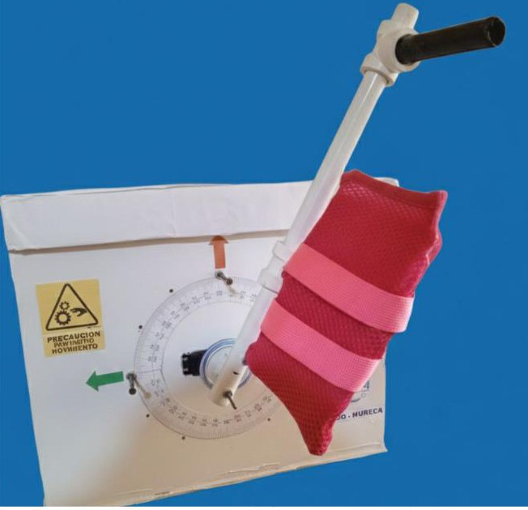
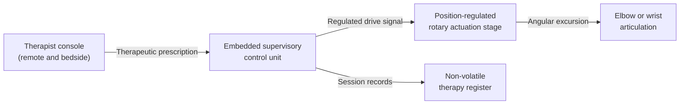
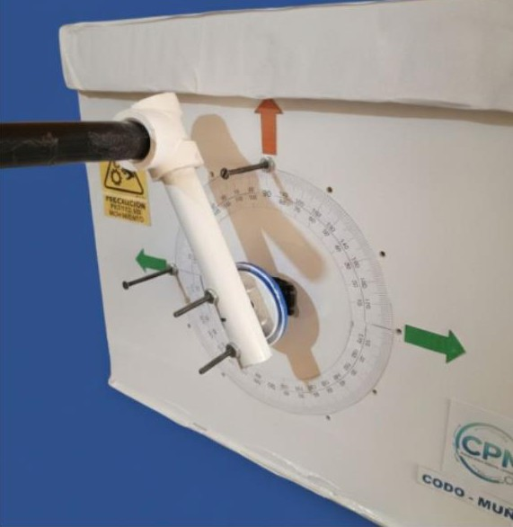
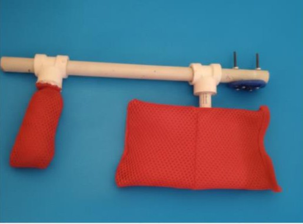
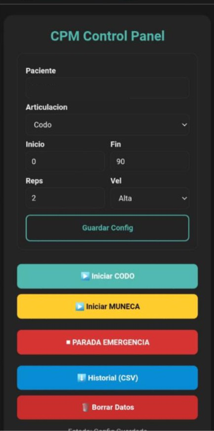

  <h1>Upper-Limb Continuous Passive Motion Rehabilitation Armed Prototype With recycled components.</h1>
  
<em>A programmable electromechanical apparatus for the controlled, repetitive passive mobilization of the elbow and wrist joints</em>

  
  

  
   
  <em>Assembled prototype in its elbow configuration</em>

---

## Clinical motivation

Traumatic and post-surgical conditions of the elbow and wrist frequently result in a loss of articular range of motion, and early passive mobilization is a recognized component of their rehabilitation. In Venezuela, access to continuous passive motion (CPM) equipment is limited by its acquisition cost. This project set out to build a local apparatus capable of delivering repeatable, parameterized passive mobilization for physiotherapy settings with limited resources or limited staff.

---

## Principle of operation

The apparatus imposes a slow, cyclic angular excursion on the treated joint while the patient remains passive. The therapist prescribes the excursion, and the system reproduces it with minimal variation across repetitions.

---

## The prototype

<table>
  <tr>
    <td width="50%" align="center">
      
       <em>Articulation stage and goniometric scale</em>
    </td>
    <td width="50%" align="center">
      
       <em>Padded limb support assembly</em>
    </td>
  </tr>
</table>

The system integrates four elements:

- **Mechanical assembly:** a rigid enclosure and a limb support with interchangeable elbow and wrist configurations.
- **Embedded supervisory control:** interprets the prescription, generates the motion profile and oversees the state of the session.
- **Clinical interfaces:** bedside controls at the point of care and a remote console that runs in a web browser.
- **Therapy register:** retains a chronological record of sessions on the device itself.

  
   
  <em>Remote therapist console in operation</em>

---

## Capabilities

- Independent treatment protocols for the elbow and the wrist.
- Prescription of the initial angle, final angle, number of repetitions and angular velocity.
- Three angular velocity levels: 3, 5 and 7 °/s.
- Piecewise angular calibration, which reconciles the commanded position with the physically measured excursion.
- Therapist-initiated interruption of the session, followed by resumption of the protocol or return of the limb.
- Longitudinal session records for review by the treating professional.

---

## Authorship

**Gustavo Matheus** ([GMProspect](https://github.com/GMProspect)), Instrumentation Specialist and Embedded Systems Developer
- Designed and developed all of the software: embedded control, therapist console and session records.
- Provided the assembly guidance for the prototype.
- Selected and supplied the components.
- Took part in the wiring and integration of the system.

**María Alejandra Linares Muñoz**, Electronic Engineering
- Author of the undergraduate thesis that documents the prototype.

The thesis, *Sistema de Movilidad Pasiva Continua para la Rehabilitación de Extremidades Superiores con Control Adaptativo* (Continuous Passive Mobility System for Upper-Limb Rehabilitation with Adaptive Control), was presented at the Instituto Universitario Politécnico "Santiago Mariño", Maracaibo, in January 2026.

---

## Timeline

| Period | Milestone |
|---|---|
| 2025 | Project developed and completed during our internship |
| 2026 | Reopened by the methodology advisor; software rewritten and extended; thesis presented |

---

This repository presents the project and its results. The entire project is private.
