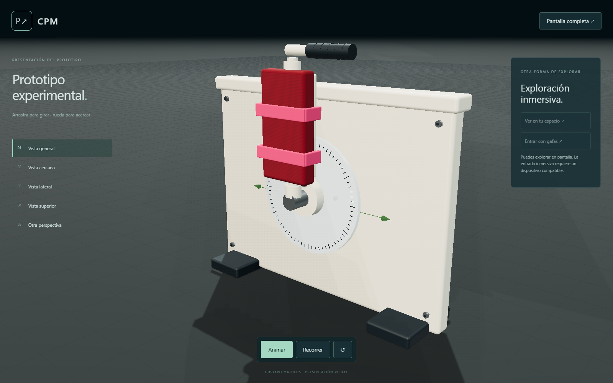

# Upper-Limb Rehabilitation Prototype

*Academic rehabilitation-engineering project*

A physical electromechanical prototype was designed and assembled as part of an academic rehabilitation-engineering project. An accompanying three-dimensional presentation illustrates its overall configuration and movement.

The digital scene is a visual demonstration. It does not provide treatment recommendations or control a physical device.

[Open the presentation](https://gmprospect.github.io/rehab-robot-arm-medical/)

## Authorship

**Gustavo Matheus** ([GMProspect](https://github.com/GMProspect)) — Software and system development.

**María Alejandra Linares Muñoz** — Academic thesis, Electronic Engineering.
